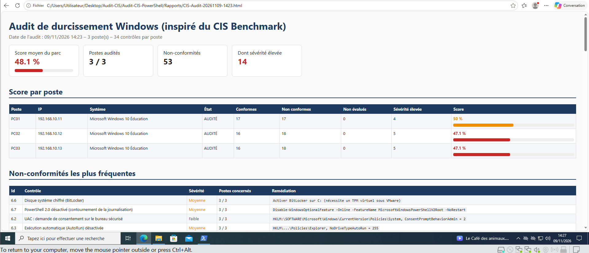
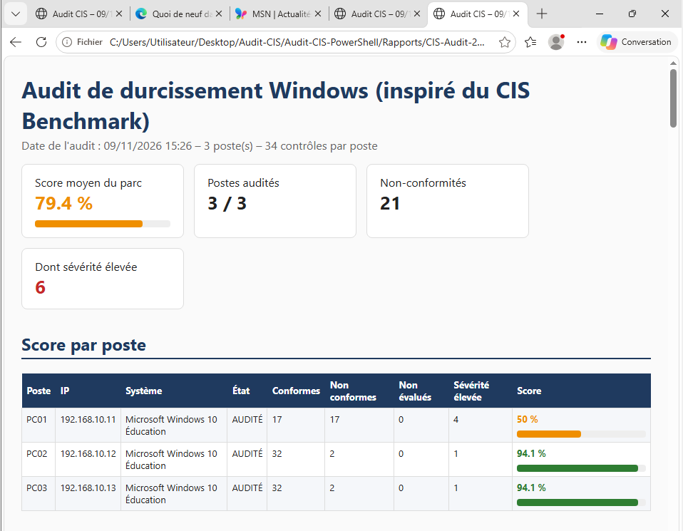

# Audit de durcissement Windows inspiré du CIS Benchmark (PowerShell)

Outil PowerShell qui audite **à distance** (WinRM) la configuration de sécurité d'un parc
Windows à partir d'une sélection de **34 contrôles inspirés du CIS Microsoft Windows 10
Benchmark (niveau 1)**, calcule un **score de conformité par poste** et produit un
rapport **HTML** et **CSV**. Un second script applique les corrections sans risque,
ce qui permet de mesurer le gain de sécurité **avant / après**.

> Projet personnel réalisé sur un lab VMware de 3 postes Windows 10.

## Objectifs

- Vérifier automatiquement le niveau de durcissement de plusieurs postes depuis un poste d'administration.
- Prioriser les écarts par sévérité (élevée, moyenne, faible).
- Corriger les écarts courants de façon reproductible, puis prouver l'amélioration par un nouvel audit.

## Architecture

```
            WinRM (5985)
PC01  ───────────────────►  PC02, PC03
(admin)   Invoke-Command    (postes audités)
   │
   └──► Rapports/CIS-Audit-<date>.html / .csv / CIS-Audit.log
```

| Poste | IP | Rôle |
|---|---|---|
| PC01 | 192.168.10.11 | Poste d'administration (lance les scripts) et poste audité |
| PC02 | 192.168.10.12 | Poste audité |
| PC03 | 192.168.10.13 | Poste audité |

## Contrôles vérifiés (34)

| Catégorie | Exemples de contrôles |
|---|---|
| Mots de passe et verrouillage (6) | Longueur ≥ 14, complexité, historique ≥ 24, verrouillage après 5 échecs |
| Comptes (3) | Compte Invité et Administrateur intégré désactivés, taille du groupe Administrateurs |
| Réseau (7) | SMBv1 désactivé, signature SMB, LLMNR désactivé, NTLMv2 uniquement, RDP/NLA, WinRM chiffré et sans Basic |
| Pare-feu (4) | Activé sur les profils Domaine, Privé et Public, entrant bloqué par défaut |
| Antivirus (2) | Protection Defender en temps réel, signatures de moins de 7 jours |
| Système (7) | UAC, AutoRun, Windows Update, Registre à distance, BitLocker, PowerShell 2.0 désactivé |
| Journalisation (5) | Script Block Logging, taille du journal Sécurité, audit des ouvertures de session, des comptes et des processus |

## Utilisation

Prérequis : PowerShell Remoting activé sur les postes (`Enable-PSRemoting -Force`) et un compte administrateur.

```powershell
# 1. Audit initial (lecture seule)
.\scripts\Invoke-CISAudit.ps1

# 2. Voir ce que la remédiation changerait, sans rien modifier
.\scripts\Invoke-CISRemediation.ps1 -Simulation

# 3. Appliquer les corrections (ici sur PC02 seulement)
.\scripts\Invoke-CISRemediation.ps1 -Computers PC02

# 4. Nouvel audit pour mesurer le gain
.\scripts\Invoke-CISAudit.ps1
```

Les rapports sont créés dans `Rapports/`.

## Résultats

Audit réalisé le 9 novembre 2026. PC01 est conservé non corrigé comme **poste témoin**.

| Poste | Score avant | Score après | Non-conformités |
|---|---|---|---|
| PC01 (témoin) | 50,0 % | 50,0 % | 17 → 17 |
| **PC02** | 47,1 % | **94,1 %** | **18 → 2** |
| **PC03** | 47,1 % | **94,1 %** | **18 → 2** |
| **Parc** | 48,1 % | **79,4 %** | 53 → 21 |

Les 2 écarts restants sur les postes durcis sont des limites du lab, acceptées et documentées :
signatures Defender non mises à jour (pas d'accès Internet) et BitLocker (pas de TPM virtuel).

📄 **Rapport d'audit complet (PDF) : [`docs/Rapport-Audit-CIS.pdf`](docs/Rapport-Audit-CIS.pdf)**

| Avant | Après |
|---|---|
|  |  |

## Choix techniques

- **Lecture seule pour l'audit** : l'audit et la correction sont deux scripts séparés.
- **Remédiation prudente** : les mesures qui pourraient couper l'accès au lab (désactivation du compte Administrateur intégré, WinRM, RDP, BitLocker) sont signalées mais pas appliquées automatiquement.
- **Indépendance de la langue** : la stratégie d'audit est lue par GUID de sous-catégorie, pour fonctionner sur un Windows en français comme en anglais.
- **Robustesse** : un poste injoignable est signalé INACCESSIBLE sans interrompre l'audit ; un contrôle impossible à évaluer est marqué NON EVALUE.

## Difficultés résolues

- **Faux positif lié à la langue** : sur un Windows en français, `auditpol` renvoie « Réussite » au lieu de « Succès » (avec un encodage altéré). La valeur est désormais normalisée, quelle que soit la langue du système.
- **Redémarrage à distance** : `Restart-Computer -ComputerName` passe par RPC, bloqué par le pare-feu durci ; le redémarrage est lancé via WinRM.

## Limites

- Sélection pédagogique de 34 contrôles, pas une implémentation complète du CIS Benchmark (plus de 300 recommandations).
- Postes hors domaine : pas de GPO ; en entreprise, ces réglages seraient déployés par stratégie de groupe.

## Auteur

Leslie Kamguem Tadjuidje – étudiante ingénieure en cybersécurité, EFREI Paris.
